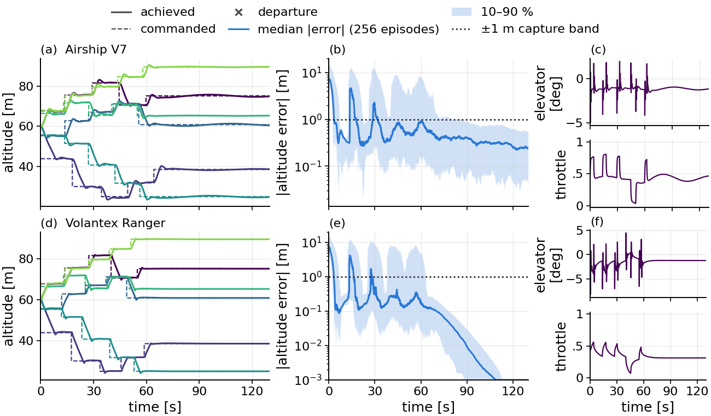
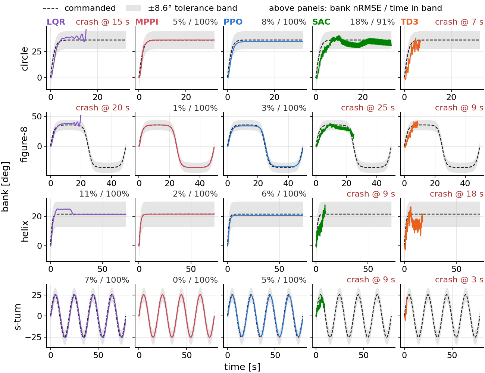
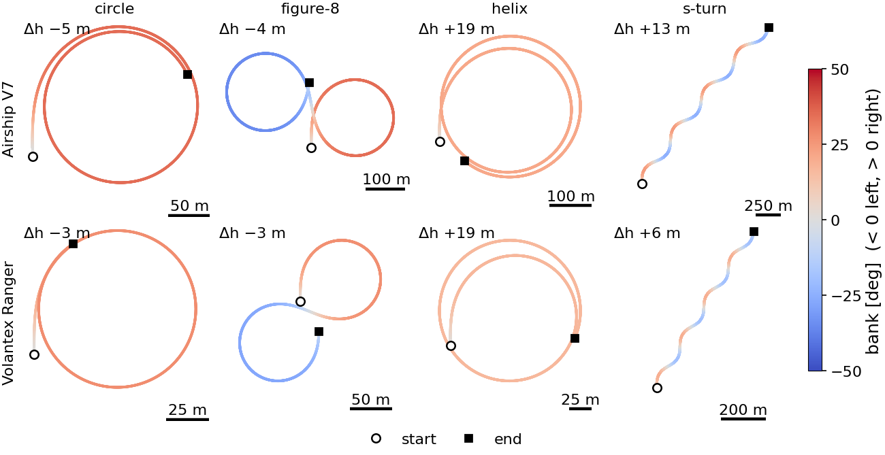
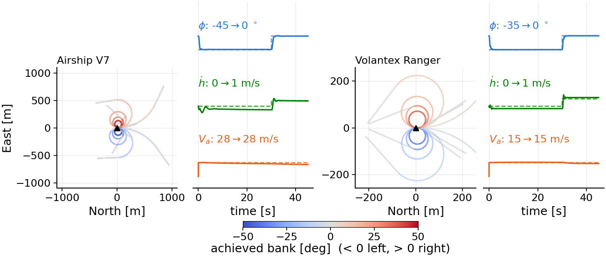
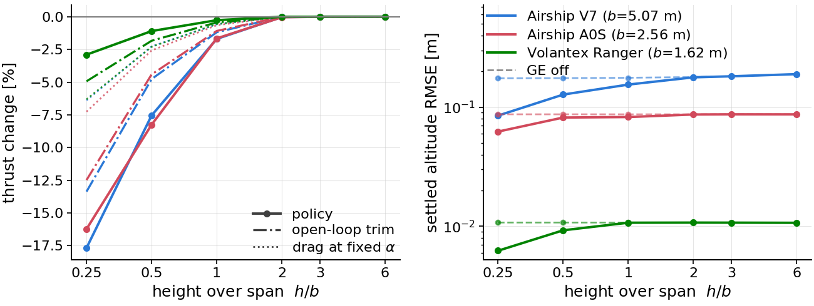
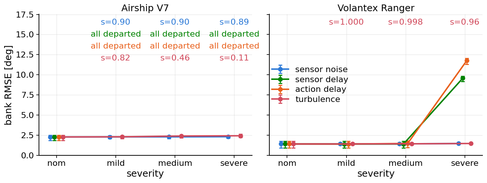
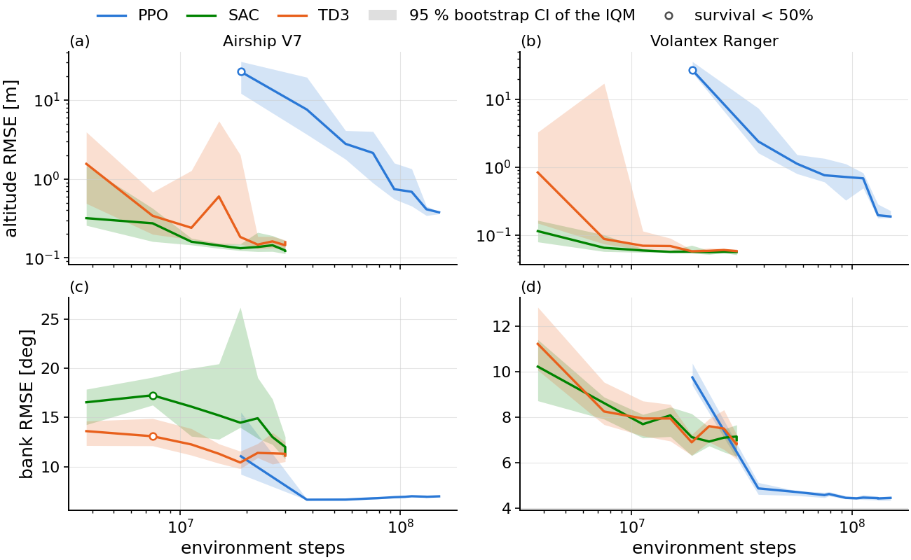
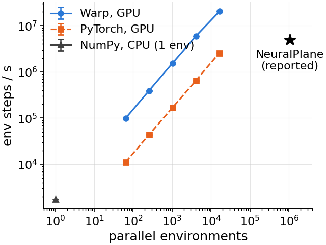

# FALCON-S

A simulation framework and controller benchmark for fixed-wing flight close to the ground.

Six-degree-of-freedom rigid-body dynamics with semi-empirical ground effect, actuator dynamics,
sensor noise and Dryden turbulence, across five airframes. Three independent plants — a NumPy
reference, a PyTorch twin and an NVIDIA Warp implementation that steps tens of thousands of
environments in parallel — validated against each other to single-step parity. Reinforcement
learning (PPO, SAC, TD3) and classical control (LQR, MPPI) drive the same command interface through
the same models, so a comparison measures the controller and not the task encoding.

**Project page:** [docs/index.html](docs/index.html), with the benchmark tables, the paper figures
and an interactive replay of the recorded flights. The page draws them with JavaScript; in a
viewer that blocks scripts by default, such as the anonymized repository's, press **JS on**. The
[Results](#results) section below carries the same content as plain tables and figures.

**Contents:** [Results](#results) · [Requirements](#requirements) · [Install](#install) ·
[Commands](#commands) · [Reproducing the shipped results](#reproducing-the-shipped-results) ·
[Layout](#layout) · [Tests](#tests)

## Results

Every number below is read from the CSVs in `results/`, which `falcons benchmark` writes and
`falcons reproduce` re-flies (`docs/tools/readme_tables.py` regenerates these tables from them).
The benchmark runs five controllers on two airframes, the **Airship V7** wing-in-ground-effect
prototype and the **Volantex Ranger** RC aircraft, under identical conditions: the same plant,
actuator and sensor models, reference and scoring. Learned policies (PPO, SAC, TD3) are pooled over
**five training seeds** (`checkpoints/`, 63 policies), MPPI over three (altitude) or five
(maneuvers) sampling draws; the LQR is deterministic. Errors are the **interquartile mean (IQM)**
over the surviving episodes with a **95 % hierarchical bootstrap interval** in brackets; survival
and acquisition are rates over every episode with a 95 % interval, so a cell never hides the runs it
dropped. Hardware: one RTX 4090.

### Altitude acquisition and hold

Each episode starts 12–18 m above or below a commanded altitude between 20 and 100 m; every
controller follows the same reference, which ramps to the target at the airframe's rate limit and
then holds. **Survival** counts episodes that end without a crash or stall; **acquired** counts
those that also reach the target and stay within ±1 m. Settled error is the altitude RMSE over the
hold; settling time is set by the reference ramp, not by the controller.

<!-- TABLE:altitude -->
| Airframe | Method | Episodes | Survival | Acquired (±1 m) | Settled error [m] | Settling time [s] | Overshoot [m] |
|---|---|--:|--:|--:|--:|--:|--:|
| Airship V7 | PPO | 1000 | 1.00 [1.00, 1.00] | 1.00 [1.00, 1.00] | 0.267 [0.240, 0.291] | 7.5 [7.4, 7.5] | 0.77 [0.73, 0.79] |
| Airship V7 | SAC | 1000 | 0.96 [0.87, 1.00] | 0.96 [0.87, 1.00] | 0.009 [0.005, 0.025] | 7.5 [7.4, 7.6] | 0.42 [0.33, 0.58] |
| Airship V7 | TD3 | 1000 | 0.98 [0.95, 1.00] | 0.92 [0.75, 1.00] | 0.017 [0.003, 0.053] | 7.5 [7.3, 7.6] | 0.49 [0.31, 0.80] |
| Airship V7 | LQR | 50 | 1.00 [0.93, 1.00] | 1.00 [0.93, 1.00] | 3.1×10<sup>-4</sup> [2.7×10<sup>-4</sup>, 3.4×10<sup>-4</sup>] | 9.7 [9.3, 10.0] | 1.51 [1.49, 1.54] |
| Airship V7 | MPPI | 150 | 0.99 [0.95, 1.00] | 0.99 [0.95, 1.00] | 0.048 [0.046, 0.051] | 7.4 [7.2, 7.6] | 0.18 [0.17, 0.20] |
| Volantex Ranger | PPO | 1000 | 1.00 [1.00, 1.00] | 1.00 [1.00, 1.00] | 0.011 [0.008, 0.015] | 7.4 [7.3, 7.7] | 0.75 [0.71, 0.80] |
| Volantex Ranger | SAC | 1000 | 0.97 [0.91, 1.00] | 0.97 [0.91, 1.00] | 0.003 [7.8×10<sup>-4</sup>, 0.012] | 7.3 [7.1, 7.5] | 0.52 [0.50, 0.53] |
| Volantex Ranger | TD3 | 1000 | 1.00 [1.00, 1.00] | 0.68 [0.30, 0.98] | 0.368 [0.002, 3.17] | 7.2 [7.1, 7.3] | 0.25 [0.16, 0.33] |
| Volantex Ranger | LQR | 50 | 1.00 [0.93, 1.00] | 1.00 [0.93, 1.00] | 1.3×10<sup>-13</sup> [9.1×10<sup>-14</sup>, 1.7×10<sup>-13</sup>] | 7.8 [7.6, 8.1] | 1.07 [1.02, 1.12] |
| Volantex Ranger | MPPI | 150 | 1.00 [0.98, 1.00] | 1.00 [0.98, 1.00] | 0.100 [0.093, 0.109] | 7.5 [7.3, 7.7] | 0.34 [0.28, 0.43] |
<!-- /TABLE:altitude -->

- **Every method now acquires the target on both airframes, but not every run.** PPO survives and
  acquires all 1,000 episodes on each airframe. SAC drops 4 % (V7) and 3 % (Ranger) of its
  episodes, and TD3 on the Ranger survives every episode yet acquires only 68 %, with an interval
  of [30 %, 98 %] across seeds: one checkpoint alone would place it anywhere in that range.
- **Where they survive, the off-policy methods settle tighter than PPO.** SAC holds 0.009 m (V7)
  and 0.003 m (Ranger) against PPO's 0.267 m and 0.011 m; PPO buys its reliability with a
  steady-state offset on the V7.
- **The LQR is the most precise regulator.** On a constant reference the task reduces to the linear
  regulation problem its gains solve: 3×10⁻⁴ m on the V7 and round-off on the Ranger. It also
  overshoots most (1.5 m and 1.1 m).
- **MPPI acquires 99–100 % with the smallest overshoot** (0.18 m and 0.34 m), at a settled error of
  5–10 cm. Its cost tracks the reference climb rate over a 2 s preview.
- Settling times (7.2–9.7 s) are set by the rate limit of the reference, not by the controller.



*PPO flying a sequence of altitude targets: each target is released once the previous one is held.
The same figure for SAC and TD3: [`fig_altitude_viz_sac`](results/figures/fig_altitude_viz_sac.png),
[`fig_altitude_viz_td3`](results/figures/fig_altitude_viz_td3.png).*

### Attitude-command tracking

A maneuver is a stream of bank, climb-rate and airspeed commands (circle, figure-of-eight, helix,
s-turn), generated from each airframe's own envelope; all five executors receive the identical
stream and drive the same plant. Cells give the bank-angle RMSE in degrees, IQM [95 % CI] over runs.

<!-- TABLE:maneuvers -->
| Airframe | Method | Circle | Figure-8 | Helix | S-turn |
|---|---|--:|--:|--:|--:|
| Airship V7 | PPO | 2.2 [1.8, 2.2] | 2.4 [2.2, 2.5] | 1.0 [0.7, 1.1] · 2 departed | 2.5 [2.4, 2.8] |
| Airship V7 | SAC | 4.8 [4.8, 4.8] · 4 departed | – · 5 departed | – · 5 departed | – · 5 departed |
| Airship V7 | TD3 | – · 5 departed | – · 5 departed | – · 5 departed | – · 5 departed |
| Airship V7 | LQR | – · 1 departed | – · 1 departed | 1.7 [1.7, 1.7] | 3.5 [3.5, 3.5] |
| Airship V7 | MPPI | 1.2 [0.8, 2.0] | 0.6 [0.4, 1.1] | 0.3 [0.1, 0.5] | 0.2 [0.1, 0.3] |
| Volantex Ranger | PPO | 1.1 [1.1, 1.2] | 1.7 [1.7, 1.7] | 0.4 [0.4, 0.5] | 2.0 [1.9, 2.0] |
| Volantex Ranger | SAC | 5.1 [3.8, 5.9] | 5.8 [5.0, 7.4] | 4.6 [3.6, 7.6] | 6.9 [5.0, 7.8] |
| Volantex Ranger | TD3 | 6.6 [5.4, 9.7] | 7.3 [6.2, 9.0] | 5.6 [4.2, 7.9] | 6.2 [4.8, 7.9] |
| Volantex Ranger | LQR | 1.8 [1.8, 1.8] | 2.0 [2.0, 2.0] | 1.6 [1.6, 1.6] | 1.9 [1.9, 1.9] |
| Volantex Ranger | MPPI | 0.4 [0.2, 1.0] | 0.4 [0.2, 0.8] | 0.2 [0.1, 0.2] | 0.2 [0.2, 0.3] |
<!-- /TABLE:maneuvers -->

- **MPPI is the most accurate executor on all eight cells** (0.2–1.2° on the V7, 0.2–0.4° on the
  Ranger) and never departs: with the commanded quantity itself a rate, its 2 s preview is enough.
- **PPO tracks every cell within 0.4–2.5°.** Two of its five seeds depart the V7 helix.
- **SAC and TD3 did not learn the V7 attitude task.** Their own periodic evaluation during training
  survives 0.1–4 % of episodes, and in the benchmark they depart 19 and 20 of 20 runs. On the
  Ranger both stay in the envelope but track at 4.6–7.3°, three times looser than PPO.
- **The LQR holds the Ranger to 1.6–2.0° but departs the V7 circle and figure-of-eight.** Those
  streams command 36° of bank; its gains are linearized about level trim and the measured envelope
  ends at 30° on the V7 (table below).







The LQR gains are linearized about level trim, so its bank envelope is measured separately
(`scripts/lqr_envelope.py`): one constant-bank turn per angle, held for 1.3 turn periods, inside
the envelope when the run survives and holds the ±8.6° band for 90 % of the time. The Ranger holds
every bank to 45°; the V7 departs from 35°, which is why it leaves the 36° circle and figure-of-eight.

<!-- TABLE:lqr_envelope -->
| Bank error [deg] at | 5° | 10° | 15° | 20° | 25° | 30° | 35° | 40° | 45° |
|---|--:|--:|--:|--:|--:|--:|--:|--:|--:|
| Airship V7 | 0.23 | 0.44 | 0.63 | 0.83 | 1.13 | 1.71 | departs | departs | departs |
| Volantex Ranger | 0.42 | 0.83 | 1.19 | 1.49 | 1.72 | 1.86 | 1.95 | 2.06 | 2.35 |
<!-- /TABLE:lqr_envelope -->

### Ground effect

Under a stabilising controller, ground effect changes the thrust needed to fly a trajectory rather
than the trajectory itself. The open-loop trim (no controller) and the PPO altitude policy holding
a band are compared with the correction on and off at each height over span h/b, against
lifting-line theory.

<!-- TABLE:ground_effect -->
| Airframe | h/b | ΔT trim [%] | ΔT theory [%] | ΔT under PPO [%] | Error GE on [m] | Error GE off [m] |
|---|--:|--:|--:|--:|--:|--:|
| Airship V7 | 0.25 | -16.9 | -12.3 | -21.2 | 0.074 | 0.186 |
| Airship V7 | 0.50 | -6.2 | -4.1 | -7.6 | 0.011 | 0.186 |
| Airship V7 | 1.00 | -1.8 | -1.3 | -2.2 | 0.122 | 0.188 |
| Airship V7 | 2.00 | -0.4 | -0.3 | -0.5 | 0.178 | 0.190 |
| Airship V7 | 3.00 | -0.1 | -0.0 | -0.1 | 0.190 | 0.193 |
| Airship V7 | 6.00 | -0.0 | 0.0 | 0.0 | 0.201 | 0.201 |
| Airship A0S | 0.25 | -12.1 | -3.1 | – | – | – |
| Airship A0S | 0.50 | -4.7 | -1.2 | – | – | – |
| Airship A0S | 1.00 | -1.3 | -0.4 | – | 0.911 | 0.797 |
| Airship A0S | 2.00 | -0.2 | -0.1 | -0.4 | 0.780 | 0.804 |
| Airship A0S | 3.00 | -0.1 | -0.0 | -0.1 | 0.804 | 0.811 |
| Airship A0S | 6.00 | -0.0 | 0.0 | -0.0 | 0.832 | 0.832 |
| Volantex Ranger | 0.25 | -4.4 | -3.2 | -3.4 | 0.029 | 0.019 |
| Volantex Ranger | 0.50 | -1.8 | -1.2 | -1.5 | 0.023 | 0.019 |
| Volantex Ranger | 1.00 | -0.6 | -0.4 | -0.5 | 0.020 | 0.019 |
| Volantex Ranger | 2.00 | -0.1 | -0.1 | -0.1 | 0.019 | 0.019 |
| Volantex Ranger | 3.00 | -0.0 | -0.0 | -0.0 | 0.019 | 0.019 |
| Volantex Ranger | 6.00 | -0.0 | 0.0 | -0.0 | 0.019 | 0.019 |
| Navion | 0.25 | -4.1 | -2.7 | – | 2.27 | 2.01 |
| Navion | 0.50 | -1.7 | -1.0 | – | 2.13 | 2.01 |
| Navion | 1.00 | -0.5 | -0.3 | – | 2.05 | 2.01 |
| Navion | 2.00 | -0.1 | -0.1 | – | 2.01 | 2.00 |
| Navion | 3.00 | -0.0 | -0.0 | – | 2.00 | 2.00 |
| Navion | 6.00 | -0.0 | 0.0 | – | 1.99 | 1.99 |
| Cirrus SR22 | 0.25 | -3.8 | -2.9 | – | – | – |
| Cirrus SR22 | 0.50 | -1.6 | -1.1 | – | – | – |
| Cirrus SR22 | 1.00 | -0.5 | -0.4 | – | – | – |
| Cirrus SR22 | 2.00 | -0.1 | -0.1 | – | 7.83 | 7.86 |
| Cirrus SR22 | 3.00 | -0.0 | -0.0 | – | 7.86 | 7.86 |
| Cirrus SR22 | 6.00 | -0.0 | 0.0 | – | 7.88 | 7.88 |
<!-- /TABLE:ground_effect -->

- **Near the surface, the same flight costs less thrust.** At h/b = 0.25 the V7 trims at 60.6 N
  against 72.9 N out of ground effect (−16.9 %), the A0S saves 12.1 %, and the three conventional
  airframes 3.8–4.4 %. The effect vanishes by h/b ≈ 2.
- **The simulator saves more than lifting-line theory predicts** (−16.9 % against −12.3 % on the
  V7), because the prediction holds the lift coefficient fixed while the aircraft re-trims: with
  the angle of attack frozen at its out-of-ground-effect 2.14° the V7 drag is 63.9 N, against
  60.6 N when it re-trims to 1.68°.
- **Under the PPO altitude policy the saving holds and grows** (−21.2 % on the V7 at h/b = 0.25),
  with settled altitude error below 0.21 m (V7) and 0.03 m (Ranger), correction on or off. A cell
  marked – is a band the policy does not hold (`hold_valid = 0` in `results/ge_energy.csv`): the
  A0S below h/b = 2, and the Navion and Cirrus SR22 policies at every height.



**Does training in ground effect matter?** Each PPO altitude policy (five seeds) is fine-tuned
twice on a near-ground band (h/b 0.20–0.46), once with the correction on and once with it off,
then flown with it on and off: a 2 × 2 of train GE × evaluation GE, plus a 30 m band as a
forgetting check (`falcons benchmark ge-training`). The deploy penalty is the error a policy
trained without ground effect loses when deployed with it; the interaction term is positive when
the gain is specific to ground effect.

<!-- TABLE:ge_training -->
| Airframe | Band | Fine-tuned | Flown with GE | Survival | Altitude error [m] |
|---|---|---|---|--:|--:|
| Airship V7 | near ground | with GE | on | 1.00 [1.00, 1.00] | 0.210 [0.199, 0.221] |
| Airship V7 | near ground | with GE | off | 0.26 [0.24, 0.29] | 0.654 [0.650, 0.659] |
| Airship V7 | near ground | without GE | on | 1.00 [1.00, 1.00] | 0.540 [0.530, 0.551] |
| Airship V7 | near ground | without GE | off | 1.00 [1.00, 1.00] | 0.211 [0.206, 0.217] |
| Airship V7 | 30 m | with GE | on | 1.00 [1.00, 1.00] | 1.35 [1.34, 1.35] |
| Airship V7 | 30 m | with GE | off | 1.00 [1.00, 1.00] | 1.35 [1.34, 1.35] |
| Airship V7 | 30 m | without GE | on | 1.00 [1.00, 1.00] | 0.251 [0.246, 0.257] |
| Airship V7 | 30 m | without GE | off | 1.00 [1.00, 1.00] | 0.252 [0.246, 0.257] |
| Volantex Ranger | near ground | with GE | on | 1.00 [1.00, 1.00] | 0.093 [0.092, 0.094] |
| Volantex Ranger | near ground | with GE | off | 1.00 [1.00, 1.00] | 0.050 [0.050, 0.050] |
| Volantex Ranger | near ground | without GE | on | 1.00 [1.00, 1.00] | 0.163 [0.162, 0.164] |
| Volantex Ranger | near ground | without GE | off | 1.00 [1.00, 1.00] | 0.127 [0.126, 0.127] |
| Volantex Ranger | 30 m | with GE | on | 1.00 [1.00, 1.00] | 0.046 [0.046, 0.047] |
| Volantex Ranger | 30 m | with GE | off | 1.00 [1.00, 1.00] | 0.046 [0.046, 0.047] |
| Volantex Ranger | 30 m | without GE | on | 1.00 [1.00, 1.00] | 0.123 [0.123, 0.123] |
| Volantex Ranger | 30 m | without GE | off | 1.00 [1.00, 1.00] | 0.123 [0.123, 0.123] |

| Airframe | Band | Effect | Value [m] |
|---|---|---|--:|
| Airship V7 | near ground | deploy penalty | 0.331 [0.315, 0.346] |
| Airship V7 | near ground | interaction | 0.774 [0.756, 0.791] |
| Airship V7 | 30 m | deploy penalty | -1.10 [-1.10, -1.09] |
| Airship V7 | 30 m | interaction | 3.1×10<sup>-5</sup> [-0.011, 0.011] |
| Volantex Ranger | near ground | deploy penalty | 0.070 [0.068, 0.071] |
| Volantex Ranger | near ground | interaction | -0.007 [-0.008, -0.006] |
| Volantex Ranger | 30 m | deploy penalty | 0.077 [0.076, 0.077] |
| Volantex Ranger | 30 m | interaction | 0 [-4.9×10<sup>-4</sup>, 4.6×10<sup>-4</sup>] |
<!-- /TABLE:ge_training -->

- **On the V7 it matters, and the policy learns to rely on it.** Deployed with ground effect, the
  policy fine-tuned without it holds 0.54 m against 0.21 m for the one fine-tuned with it, a deploy
  penalty of 0.33 m [0.32, 0.35]. The policy fine-tuned with ground effect survives only 26 % of
  episodes when the effect is switched off: it has learned to fly on the extra lift. The
  interaction term, 0.77 m [0.76, 0.79], says the gain is specific to ground effect.
- **On the Ranger the gain is generic.** Fine-tuning with the correction on also helps without it
  (0.05–0.09 m against 0.13–0.16 m), and the interaction term is −0.007 m: a better fine-tune,
  not a ground-effect skill. Its saving at h/b = 0.25 is a quarter of the V7's (table above).
- **Fine-tuning near the ground costs the V7 its 30 m regime in one arm only**: the child
  fine-tuned with ground effect holds 1.35 m at 30 m, against 0.25 m for the one fine-tuned
  without. The Ranger keeps its 30 m accuracy in both arms.

### Robustness

The PPO attitude executor flies all four maneuvers under one disturbance family at a time, at
three severities set in physical units (100 noise or gust realizations per seed, maneuver and
severity). A disturbance corrupts what the policy sees or commands; every metric comes from the
true simulator state. The severities are derived in
[docs/disturbance_model.md](docs/disturbance_model.md).

| Family | Mild | Medium | Severe | Models |
|---|---|---|---|---|
| Sensor noise | φ,θ 0.5° · p,q,r 1°/s | 1.0° · 2°/s | 2.0° · 5°/s | Gaussian floors per channel, also on V<sub>a</sub>, α, β, ż |
| Sensor delay | 20 ms | 40 ms | 80 ms | estimator and sensor-pipeline latency |
| Action delay | 20 ms | 50 ms | 100 ms | flight computer, link and servo dead-time |
| Turbulence | σ<sub>u</sub>/V<sub>a</sub> 0.05 | 0.10 | 0.15 | Dryden gusts, MIL-F-8785C intensity relation (W<sub>20</sub> 9.1/18.2/27.3 m/s on the V7) |

<!-- TABLE:robustness -->
| Airframe | Disturbance | Severity | Bank error [deg] | Survival |
|---|---|---|--:|--:|
| Airship V7 | Nominal | – | 2.3 [1.9, 2.5] | 0.90 |
| Airship V7 | Sensor noise | mild | 2.3 [2.1, 2.4] | 0.90 |
| Airship V7 | Sensor noise | medium | 2.3 [2.1, 2.4] | 0.90 |
| Airship V7 | Sensor noise | severe | 2.3 [2.1, 2.5] | 0.89 |
| Airship V7 | Sensor delay | mild | – | 0.00 |
| Airship V7 | Sensor delay | medium | – | 0.00 |
| Airship V7 | Sensor delay | severe | – | 0.00 |
| Airship V7 | Action delay | mild | – | 0.00 |
| Airship V7 | Action delay | medium | – | 0.00 |
| Airship V7 | Action delay | severe | – | 0.00 |
| Airship V7 | Turbulence | mild | 2.3 [2.1, 2.4] | 0.82 |
| Airship V7 | Turbulence | medium | 2.4 [2.2, 2.5] | 0.46 |
| Airship V7 | Turbulence | severe | 2.4 [2.2, 2.6] | 0.11 |
| Volantex Ranger | Nominal | – | 1.4 [0.9, 1.7] | 1.00 |
| Volantex Ranger | Sensor noise | mild | 1.4 [1.4, 1.5] | 1.00 |
| Volantex Ranger | Sensor noise | medium | 1.4 [1.4, 1.5] | 1.00 |
| Volantex Ranger | Sensor noise | severe | 1.5 [1.4, 1.5] | 1.00 |
| Volantex Ranger | Sensor delay | mild | 1.4 [0.9, 1.7] | 1.00 |
| Volantex Ranger | Sensor delay | medium | 1.4 [0.9, 1.7] | 1.00 |
| Volantex Ranger | Sensor delay | severe | 9.6 [9.2, 9.8] | 1.00 |
| Volantex Ranger | Action delay | mild | 1.4 [0.9, 1.7] | 1.00 |
| Volantex Ranger | Action delay | medium | 1.5 [1.0, 1.8] | 1.00 |
| Volantex Ranger | Action delay | severe | 11.8 [11.3, 12.1] | 1.00 |
| Volantex Ranger | Turbulence | mild | 1.4 [1.4, 1.5] | 1.00 |
| Volantex Ranger | Turbulence | medium | 1.4 [1.4, 1.5] | 1.00 |
| Volantex Ranger | Turbulence | severe | 1.5 [1.4, 1.5] | 0.96 |
<!-- /TABLE:robustness -->

- **Sensor noise costs nothing.** Bank error holds at 2.3° on the V7 and moves from 1.4 to 1.5° on
  the Ranger across the whole grid.
- **The V7 executor has no latency margin.** Every run departs under any delay, sensor or action,
  from the mildest 20 ms. Re-flying single runs shows a dead-time instability that grows with the
  delay: a departure after about 20 s at one 10 ms step, 4.6 s at 20 ms, 2.4 s at 50 ms.
- **The Ranger absorbs both latencies up to the medium grid with no loss.** At the severe grid its
  error rises to 9.6° (80 ms sensor) and 11.8° (100 ms action), and every run survives.
- **Turbulence ends V7 runs rather than degrading them.** V7 survival falls 0.82 → 0.46 → 0.11
  across σ<sub>u</sub>/V<sub>a</sub> = 0.05 / 0.10 / 0.15 while the survivors still track at
  2.3–2.4°. The Ranger keeps 96 % of its runs at the severe grid.
- Nominal survival on the V7 is 0.90 because two of the five seeds depart the helix (see the
  maneuver table).



### Training



Learning curves of the 63 shipped runs (`results/curves/`): the periodic evaluation metric against
environment steps, IQM over the five seeds with a 95 % bootstrap band. PPO trains for 1.5×10⁸
steps, SAC and TD3 for 3×10⁷. Median wall clock per run on one RTX 4090, evaluation included
(`results/train_timings.tsv`):

| Algorithm | Altitude task | Attitude task |
|---|--:|--:|
| PPO | 6.3 min | 6.5 min |
| SAC | 66 min | 66 min |
| TD3 | 26 min | 26 min |

### Simulator throughput

<!-- TABLE:throughput -->
| Backend | Parallel envs | Env-steps / s |
|---|--:|--:|
| NumPy, CPU | 1 | 570 |
| Warp, GPU | 64 | 91,558 |
| Warp, GPU | 256 | 365,482 |
| Warp, GPU | 1,024 | 1,449,237 |
| Warp, GPU | 4,096 | 5,544,605 |
| Warp, GPU | 16,384 | 19,153,105 |
| PyTorch, GPU | 64 | 10,952 |
| PyTorch, GPU | 256 | 42,070 |
| PyTorch, GPU | 1,024 | 162,233 |
| PyTorch, GPU | 4,096 | 646,188 |
| PyTorch, GPU | 16,384 | 2,567,757 |
<!-- /TABLE:throughput -->

Env-steps per second of the altitude task on an idle RTX 4090 with a Ryzen 9 7950X, mean of ten
CUDA-fenced trials (`falcons benchmark throughput`; this sweep predates the revision). The Warp
backend scales near-linearly across the widths RL training uses; the full sweep to 2×10⁶
environments, with its peak of 73.6 M steps/s at 262,144 environments and the comparison with
NeuralPlane (13.4× at 10⁶ environments), is on the [project page](docs/index.html#throughput). The
same step also checks the GPU backends against each other: settled altitude RMSE of the Warp and
PyTorch plants agrees to within 0.008 m at every target (`results/parity.json`).



### Cross-simulator validation

Zero-input free flight from identical initial conditions in FALCON-S and JSBSim
(`tools/jsbsim_validate`): Pearson correlation and error of the two trajectories. JSBSim does not
model ground effect, so at h₀ = 1 m the comparison is made with the correction on and off; the gap
between the two isolates the correction as an aerodynamic effect rather than a numerical one.
Controller transfer to X-Plane uses the harness in `tools/xplane`.

<!-- TABLE:jsbsim -->
| Airframe | h₀ | Ground effect | r altitude | r pitch rate | r airspeed | RMSE altitude [m] | RMSE airspeed [m/s] |
|---|--:|---|--:|--:|--:|--:|--:|
| Airship V7 | 1 m | on | 0.9982 | 0.9715 | 0.9793 | 0.124 | 0.014 |
| Airship V7 | 1 m | off | 1.0000 | 0.9992 | 0.9998 | 0.002 | 0.003 |
| Airship V7 | 10 m | off | 1.0000 | 0.9989 | 1.0000 | 0.024 | 0.014 |
| Airship V7 | 100 m | off | 1.0000 | 0.9990 | 1.0000 | 0.026 | 0.015 |
| Volantex Ranger | 1 m | on | 1.0000 | 0.9954 | 0.9951 | 0.019 | 0.011 |
| Volantex Ranger | 1 m | off | 1.0000 | 0.9984 | 0.9994 | 0.002 | 0.004 |
| Volantex Ranger | 10 m | off | 1.0000 | 0.9998 | 1.0000 | 0.005 | 0.007 |
| Volantex Ranger | 100 m | off | 1.0000 | 0.9998 | 1.0000 | 0.004 | 0.007 |
<!-- /TABLE:jsbsim -->

## Requirements

Python 3.10 and an NVIDIA GPU with a CUDA 12.6 driver. The Warp plant is CUDA-only; `falcons check`
and the NumPy reference plant run without one.

## Install

```bash
git clone <this repository> falcon-s && cd falcon-s
bash scripts/setup_venv.sh      # venv → requirements.lock → editable install → falcons check
```

A Docker image is also provided: `docker build -t falcons . && docker run --rm --gpus all falcons`.

## Commands

```bash
falcons check                                     # versions, GPU, load checkpoints, step the plant

# train a policy: 3 algorithms × 2 tasks × 5 airframes × any seed
falcons train --algo ppo --task altitude  --plane Airship_V7 --seed 0
falcons train --algo sac --task attitude  --plane Volantex_Ranger --seed 1
scripts/train_seeds.sh                            # the 63 shipped runs, idempotent

# evaluate one controller on one task, learned or classical
falcons eval --algo ppo  --task altitude --plane Airship_V7 --plot
falcons eval --algo mppi --task attitude --plane Volantex_Ranger --maneuver circle

# sweep a whole protocol across airframes and methods
falcons benchmark altitude                        # acquisition and hold         3 h 35
falcons benchmark maneuvers --refresh             # four named attitude streams    25 min
falcons benchmark ground-effect                   # thrust vs height over span      3 min
falcons benchmark robustness                      # noise, latency, turbulence     44 min
falcons benchmark ge-training                     # train GE x eval GE, 2 x 2      17 min
falcons benchmark throughput                      # step rate and cross-plant parity 7 min
PYTHONPATH=src python scripts/lqr_envelope.py     # the LQR's bank envelope          4 min

falcons tables                                    # results/*.csv → results/tables.tex
falcons figures [name …]                          # → results/figures/
falcons reproduce --out DIR                       # re-fly everything and diff against results/
```

`eval` is the inner loop `benchmark` composes, so a cell printed by `eval` is the cell that lands in
the table. Runtimes are those of the shipped run, on an RTX 4090 that was shared with another job;
an idle GPU is faster. Throughput must be measured on an idle GPU.

## Layout

```
src/falcons/
  aircraft/     five airframes: geometry, polynomial aero, LQR gains
  sim/          the three plants — cpu, torch, warp
  envs/         altitude and attitude RL environments
  controllers/  LQR, MPPI, and the checkpoint loader
  train/        PPO, SAC, TD3
  benchmark/    the five protocols, the tables, the figures, reproduce
checkpoints/    63 trained policies (5 seeds × 3 algorithms × 2 tasks × 2 airframes, + 3)
results/        tables, figures and training curves from the shipped run
docs/           the project page (index.html) and the tools that build its data
```

The disturbance models used by the robustness sweep are documented in
[docs/disturbance_model.md](docs/disturbance_model.md).

## Tests

```bash
.venv/bin/pytest -q -m "not slow"     # about a minute
.venv/bin/pytest -q -m slow           # ~5 h: every protocol re-flown and diffed
```

Three tests need a rollout-cache fixture that is not in the repository; without it the fast tier
skips them. Point `FALCONS_TRACE_FIXTURE` at the cache to run them.

## Reproducing the shipped results

`falcons reproduce` re-flies every protocol from the checkpoints and diffs the outcome against
`results/`. Deterministic rows — every learned policy and the LQR — return bit-identical. MPPI is a
sampling planner, so its cells are draws and are compared within their measured spread.

## License

MIT — see `LICENSE`.
